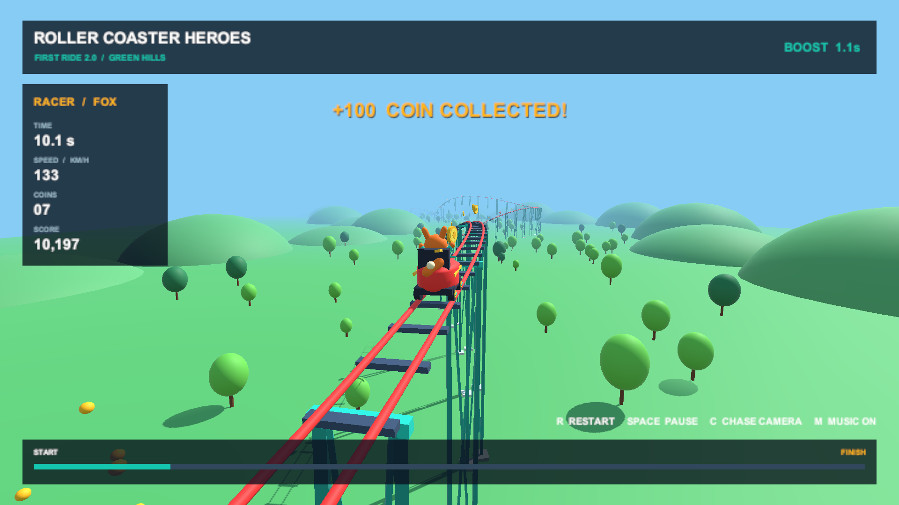
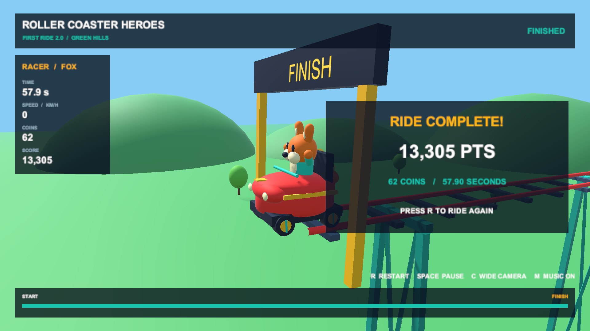

# First Ride 2.0 — проверка реализации

Дата: **14 октября 2026**. Windows 11 x64, Unity **6000.5.4f1**, URP **17.5.0**, Unity UI **2.5.0**, Intel Iris Plus Graphics, **Direct3D 11**.

## Успешные проверки

- Исходные C#-скрипты скомпилированы настоящим Unity Editor 6.5, включая игровые и Editor-компоненты.
- `FirstRide.Editor.FirstRideProject.Validate`: **PASS**. Проверены фиксированный seed, границы трассы, скорость 7–37 m/s, сбор предметов при пересечении дистанции, однократный финиш, исходная формула очков, неизменность результата после финиша и полный перезапуск.
- `FirstRide.Editor.FirstRideProject.PlaySmoke`: **PASS, exit code 0**. Два полных реальных заезда в Play Mode; повторный результат совпал. Проверены активные камера и единственный AudioListener, наличие HUD, финишная карточка, переключение камеры, mute/unmute музыки, пауза звука и остановка дистанции между кадрами, продолжение и перезапуск.
- Заезд: **57.89966 s**, **62 монеты**, **5 ускорителей**, **3 замедлителя**, **13,305.02 очка** до округления HUD. Интерфейс показывает **13,305 PTS**.
- В итоговом прогоне Play Mode: **0 ошибок времени выполнения**.
- `FirstRide.Editor.FirstRideProject.BuildWindows`: **PASS, exit code 0**, маркер `FIRST_RIDE_BUILD_OK`. Собран настоящий Windows x64 player с Mono. Сборка использует тот же исходный код, который прошёл Play Mode; Unity 6.5 разрешил встроенный Unity UI как 2.5.0, и manifest приведён к этой фактически проверенной версии.
- Полученный `.exe` отдельно запущен вне Unity Editor на NVIDIA GeForce MX250 / Direct3D 11. Player инициализировался, оставался запущенным, ошибок/исключений в его журнале не было. Полные повторные заезды и точность результатов проверены в Play Mode, как описано выше.
- Снимки камеры и HUD 1920×1080 проверены визуально: двойные рельсы и шпалы видны, опоры соединены с трассой, цвета материалов корректны, вагонетка и герой видны, карточка результата оставляет героя открытым.

## Особенности окружения

Первый импорт из глубоко вложенной папки рабочего окружения вызвал ошибки длины путей в файлах URP. Итоговая проверка выполнена в отдельной короткой временной папке с теми же исходными файлами, чистым Library и разрешёнными пакетами. В инструкции рекомендован `C:\Work\YTSuper8`.

Первоначальный запуск Direct3D 12 на установленном старом Intel-драйвере отображал неверные цвета. На Direct3D 11 визуальная проверка прошла; Windows-сборка настроена на D3D11. При первом создании индекса Search сам Unity Editor также выдавал исключение служебной индексации. Итоговый прогон после завершения инициализации редактора прошёл без ошибок; проверка запускает измерение Play Mode после окончания служебных callback.

Проверки не являются измерением производительности на всех ПК и не заменяют прослушивание звука человеком. Аудиоисточники и переключатели проверены в Play Mode, музыка и эффекты генерируются кодом. DonationAlerts, серверный турнир и OBS в этот milestone не входят.

Команды повторения: [Unity 6.5 на Windows](Unity65Windows.md). Отчёты при запуске создаются в `UnityGame/TestResults/`, логи и сборки исключены из Git.

Дополнительно выполнена [проверка в подключённом Unity Editor](LiveUnityCheck.md): установлен актуальный код в открытый проект, проверены реальные клавиши через Input System и исправлено обрезание HUD при Free Aspect. Регрессионный тест повторно прошёл с exit code 0.
