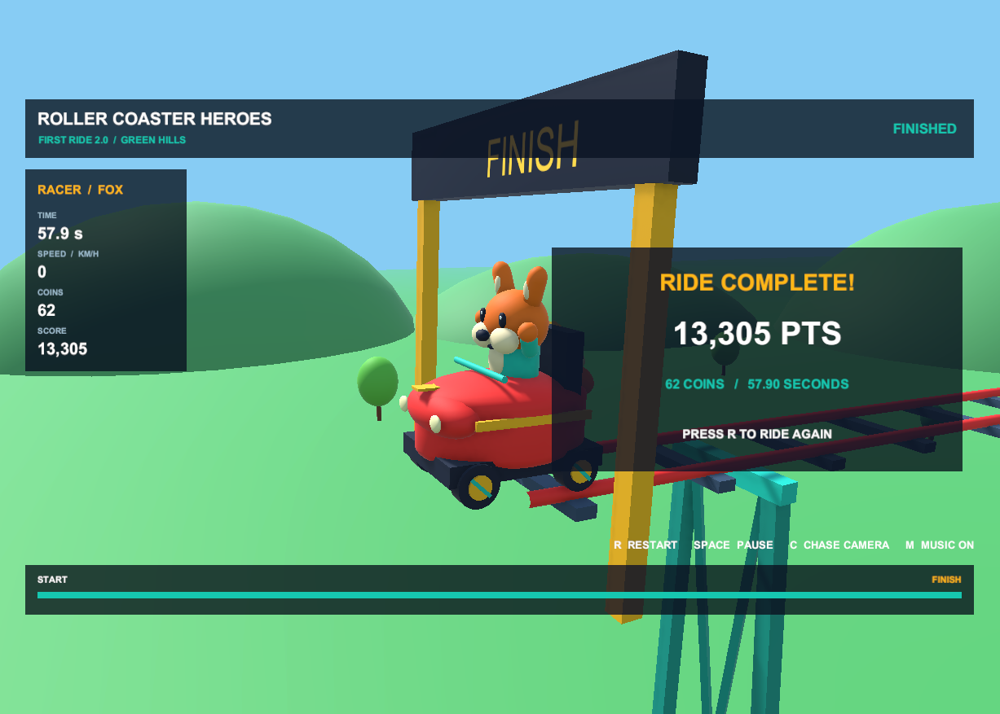

# Проверка в подключённом Unity Editor — 14 октября 2026

Проверка выполнена через Unity MCP в открытом проекте `C:\Work\YTSuper8`, Unity **6000.5.4f1**, URP **17.5.0**, NVIDIA GeForce MX250 / **Direct3D 12**, новый Input System.

## Обновление установленной копии

В открытом проекте находился исходный прототип `FirstRideBootstrap.cs`, точно совпадающий с версией до First Ride 2.0. Его копия и `.meta` сохранены в локальной папке `verification/current-project-backup` рабочего окружения проверки. В `Assets/Scripts` установлены семь игровых скриптов разработанной версии 2.0; существующий GUID загрузчика сохранён. Пакеты и исходная сцена проекта не заменялись.

## Результаты реального запуска

| Проверка | Результат |
|---|---|
| Компиляция новой версии в открытом редакторе | PASS |
| Автоматическое движение по всей трассе | PASS |
| Финиш | **57.8997 s** |
| Собрано монет | **62** |
| Счёт | **13,305.02**, в HUD **13,305 PTS** |
| Отдельная проверка модели | 70 предметов, детерминированный повтор, ограничение скорости, сброс и неизменность результата после финиша — PASS |
| Активные камера и AudioListener | Ровно по одному |
| Музыка и колёса | AudioSource воспроизводятся |
| Звуковые эффекты | SFX AudioSource воспроизводится при сборе |
| C / M / Space через Input System | Все три клавиши переключили соответствующие состояния |
| Пауза между кадрами | Дистанция и игровое время оставались равны нулю после перезапуска; звук приостановлен |
| Продолжение после паузы | PASS |
| R через Input System после финиша | PASS: новый заезд, 0 монет, время около 0.4 s на момент чтения |
| Повторный финиш после исправления HUD | 57.8997 s, 62 монеты, 13,305.02 очка |
| Итоговая консоль открытого редактора | **0 ошибок, 0 предупреждений**; только информационные сообщения Unity AI |
| Автоматический Play Mode smoke test после исправления | **PASS, exit code 0**, два полных заезда, совпадающий результат и проверка границ HUD |
| Windows x64 после исправления | Пересобран успешно, **exit code 0** |

Звуковые источники и события проверены программно; субъективное качество звука требует прослушивания человеком.

## Найденная и исправленная проблема

При Free Aspect в Game View фиксированные координаты HUD вместе с масштабированием Match Width Or Height обрезали интерфейс: при 920×386 полоса прогресса уходила ниже экрана, при 920×612 часть элементов выходила справа. Карточка финиша могла перекрывать героя.

Исправление: CanvasScaler использует **Expand**, а содержимое размещается в центрированной безопасной рамке **16:9** с `AspectRatioFitter.FitInParent`. Композиция сохраняется, при другом соотношении сторон все элементы остаются в окне. Проверка в реальном Game View **1227×877** подтвердила, что заголовок, показатели, прогресс, подсказки, уведомление и карточка результата полностью находятся внутри экрана. В автоматический Play Mode smoke test добавлена проверка границ всех видимых UI-элементов во время заезда и после финиша.

Служебные сообщения `NoSubscription` относятся к генерации ассетов Unity AI Assistant. Их наличие не мешало подключению MCP и запуску игры; это отдельная функция, для First Ride 2.0 она не требуется.
